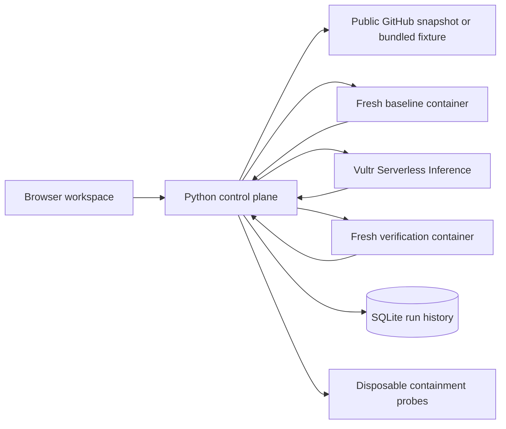

# Architecture

VersionBridge separates patch generation from the authority to execute code and certify an outcome. The browser renders the controller's events. The controller owns the test command, workspace, patch policy, and container lifecycle. The model proposes a diagnosis and a replacement line. The original test suite supplies the verification result.

## Repair lifecycle

1. The controller selects a supported repair profile and copies a bundled fixture or resolves a public GitHub reference to an immutable commit. It finds one supported source line and hashes the test files.
2. A fresh container runs the original tests. The controller requires the expected baseline failure before asking for a patch.
3. The controller sends bounded source and failure output to Vultr Serverless Inference when a key is configured. The credential-free demo uses a labeled sample patch. Migration profiles allow specific API replacements. The invoice profile permits integer arithmetic over three named inputs and rejects calls or attribute access.
4. The controller edits a temporary copy and runs the same command against the same test files in a new container. It verifies a candidate only when that command exits successfully. A live model can receive the failed patch and the new test output for one retry.
5. The UI streams the run as newline-delimited JSON. Completed runs are stored in SQLite and offer a patch and evidence download. The controller limits the repair or probe endpoint to one active run per process.

## Isolation and evidence

The control plane uses the local Docker daemon. Each run starts with a read-only root filesystem, a read-only project mount, no network, a non-root user, and dropped capabilities. Each container receives one CPU, 384 MiB of memory, and a 64-PID limit. A normal test run has a 35-second deadline. The deadline probe uses a three-second cap. The controller verifies that Docker has removed the container after the command or forced cleanup.

The evidence includes the original and patched test outputs and exit codes, patch and test hashes, container names and teardown results, the attempt count, and the imported commit when available. An authenticated model response can add a provider receipt. The diagnosis helps explain the change. The test result determines whether the candidate is accepted. [Execution security](SECURITY.md)

## Judging deployment

The web app, controller, and Docker containers run on a Vultr VM. The controller sends model requests to Vultr Serverless Inference. The public HTTPS reverse proxy supplies per-IP and global throttling. The service fails closed on missing inference credentials in the judging configuration. [Deployment guide](deploy/README.md) · [LabLab rules](https://lablab.ai/ai-hackathons/vultr-hackathon/)
