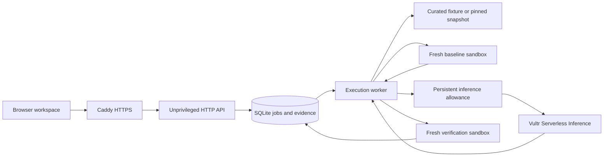

# Architecture

The HTTP service accepts validated requests and stores queued work. A separate worker controls Docker and makes model requests. The worker reproduces a failure, validates a bounded candidate, executes it in a fresh sandbox, and publishes evidence. The browser renders those recorded events.

## Processes and permissions

The production web user belongs to the shared state group and has no Docker access. Its environment has no inference key. The execution worker belongs to the Docker group and receives its own root-owned environment file. Systemd applies memory limits and restarts a failed process. Caddy proxies public HTTPS to the loopback web service.

The public deployment accepts curated workloads only. Optional Python GitHub imports are intended for a private instance until untrusted-repository isolation has been hardened and tested. The controller parses bounded manifests without executing project code. Existing repository tests execute only inside Docker.

## Repair lifecycle

1. Validate the profile and source. Retrieve an immutable snapshot when private imports are enabled.
2. Identify the single supported application source line, inspect static project metadata, and hash the existing test files.
3. Run the baseline in a new container and require a reported failing test.
4. Reserve inference allowance, request structured diagnosis and replacement, and validate the response against the profile policy. Local sample mode uses an explicitly labeled predefined candidate.
5. Modify the temporary snapshot and run the same suite in a new container.
6. Require identical test identities and skip sets, passing remaining tests, and a successful process exit.
7. Publish the patch, test outcomes, hashes, logs, attempt count, model receipt, and sandbox teardown events. Failed verification can supply feedback for one retry.

The bundled native-language examples compile and execute actual Go, Rust, Java, and C++ programs through a pytest harness. JavaScript uses Node. TypeScript includes strict compiler checks and runtime tests. PostgreSQL starts a disposable database inside its sandbox with local Unix-socket access and read-only query transactions.

## Resource limits

Each container runs as UID/GID 65534 with no network, a read-only root and project mount, no elevated capabilities, and no application credentials. Limits are one CPU, 384 MiB memory, 64 PIDs, and a 64 MiB per-file cap. Scratch space is a 128 MiB non-executable tmpfs. Native compiler profiles receive an additional bounded executable build tmpfs.

Most test runs have a 35-second deadline. The Go profile allows 75 seconds for its cold toolchain. The timeout probe uses three seconds. Docker removes each container and the worker checks that it is gone.

## Jobs and recovery

SQLite stores settings, events, terminal state, and idempotency keys. A transaction claims the oldest queued job. A process lock permits one separate worker per database. Browser polling uses event cursors and can resume the same job after a refresh.

Queued work survives a worker restart. Recorded running sandboxes are removed before interrupted jobs are marked accordingly. A cancellation takes effect at a step boundary. Terminal publication and history insertion share one database transaction. The public queue has a daily submission quota, and inference has separate persistent reservations and a daily request allowance.

## HTTP interfaces

Existing `/api/` routes also accept the `/api/v1/` prefix.

| Endpoint | Purpose |
| --- | --- |
| `GET /healthz` | HTTP process liveness |
| `GET /readyz` | Worker and runtime readiness |
| `GET /api/config` | Available profiles and enabled capabilities |
| `POST /api/jobs` | Queue a repair or containment task |
| `GET /api/jobs/ID?cursor=N` | Read incremental job events |
| `POST /api/jobs/ID` | Request cancellation |
| `GET /api/history` | Recent completed evidence |
| `GET /api/stats` | Retained outcome counts |
| `GET /api/budget` | Application inference reservations |
| `GET /api/runs/ID/report.json` | Download recorded events |
| `GET /api/runs/ID/report.md` | Download a Markdown report |
| `GET /api/runs/ID/patch` | Export a verified patch |

Private deployments can require a bearer access token on API routes. Configuration and health remain readable without a token. This is a single-workspace operator gate. Organizations, per-user ownership, private GitHub authentication, and automatic PR creation require further development.
