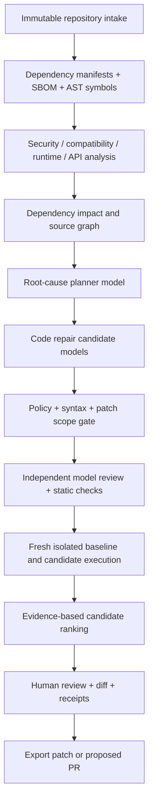

# VersionBridge AI V2 — Evidence-First Architecture Roadmap

Status: **proposed roadmap** except the explicitly identified V1 components and the opt-in two-model retry router in this branch. This document is not a claim that multi-file repairs, independent critics, or graph-based analysis have shipped.

## Current baseline (main branch)

- HTTP controller, persistent SQLite queue, separate worker and bounded Docker execution.
- Supported fixture-specific one-line repairs; optional single-function scoped Python repair.
- Manifest inventory and test reporting; Docker before/after verification and immutable patch/test hashes.
- Vultr GLM 5.3 Flash and optional private Ollama. Sample repairs are marked separately.
- Existing tests are the proof boundary; the curated 13-case provider results are not general repair accuracy.

## Desired flow

No model is permitted to change tests, weaken security controls, access host secrets, or certify its own result. Model output is untrusted. The verifier, not a model vote, decides whether a supported patch is acceptable.

## Category and engine selection

| Analysis category | Deterministic foundation | AI use | Required evidence |
| --- | --- | --- | --- |
| Dependency drift | lockfile + manifest parsers; Renovate | classify upgrade impact | resolved old/new versions and lock hashes |
| API breaking change | Tree-sitter, language tooling, OpenRewrite recipes | diagnose migration paths | locations + compiled/tested patch |
| Call-site blast radius | symbols/call graph with confidence-labelled edges | prioritize search paths | reachable affected call sites |
| Vulnerability | OSV-Scanner + CodeQL / Semgrep | explain fixes | advisory identifiers, tool versions, findings |
| Runtime failure | isolated baseline, stacktrace, test report | root-cause hypotheses | exact command, environment and failure |
| Regression | unchanged baseline suite + independent tests | propose additional test cases | immutable test inventory, outcomes |
| Performance | reproducible benchmark harness | suggest optimization | before/after metrics, variance, resource limits |
| Configuration | schema parsers + CI checks | explain misconfiguration | config diff + relevant failing checks |

### Phase 0 — Baseline and measurable evaluation

Lock down a fixture-independent holdout set of real dependency migrations. Pin repository SHA, dependency versions, runtime image digest, test inventory and time budget. Track resolved-without-regression rate, false acceptance, patch applicability, precision of affected-file prediction, time, and inference cost. Keep seeded regression rejection as a separate metric. Require no regression relative to V1 on the existing acceptance suite.

### Phase 1 — Safe model orchestration (started in this branch)

`VULTR_MODEL_POOL=MODEL_A,MODEL_B` turns on sequential model rotation only for Vultr. Attempt 1 uses A. If and only if verification rejects A, attempt 2 uses B with failed-test feedback. This requires an existing two-attempt job and still uses the current one-line profile policy, budget reservations, individual inference receipts, and sandbox. Blank/unset pool preserves V1 behavior. This is **not** a simultaneous ensemble, multi-agent consensus, or general repair agent. The pool is worker-side configuration; the public HTTP API does not accept arbitrary model IDs. Evaluate IDs supported by the account before enabling it.

### Phase 2 — Structural repository intelligence (not implemented)

Parse source and package manifests without executing code, preserve source locations, index code symbols and references, build a typed dependency graph, and assign edge certainty (exact/heuristic). Implement Python and TypeScript first. Never infer full data flow solely from imports.

### Phase 3 — Task-aware agent routing (not implemented)

Define bounded request/response schemas for a planner, repair writer, alternate writer, and critic; require distinct model credentials only if the deployment is approved and their licenses/rates fit. Route by language, failure type, context length, observed benchmark score and remaining budget. Run primary and challenger only when extra inference is likely worth the cost. Never equate agreeing models with correctness.

### Phase 4 — Multi-file repairs and verification (not implemented)

Implement an allowlisted change manifest, AST-aware edits, test and config immutability, immutable clean baseline/candidate source copies, file and line limits, reproducible offline dependencies, isolated builds, static gates, and fresh test suites. Add language adapters incrementally. Critical: do not reuse a modified candidate snapshot across independent attempts.

### Phase 5 — Explainable evidence UX (not implemented)

Render graph edges with provenance and unknown coverage, before/after tests, migration rationale, model IDs and token receipts, independent criticism, failed candidates, model disagreement, risks and review-required status. Never label a case verified without the specified checks passing.

### Phase 6 — Security and scaling (not implemented)

Harden untrusted repository execution separately from model additions. Use stronger sandbox boundaries, immutable images, bounded egress for safe dependency acquisition in a dedicated preparation phase, secret scanning, SCA, explicit human approval, signed artifacts, tenant isolation, and per-account budgets before broad public imports.

## Model benchmark guidance

- V1 recorded GLM 5.3 Flash at 13/13 and DeepSeek V4.1 Flash 1017 at 12/13 curated outcomes (see EVALUATION.md). This does not establish a general-model superiority claim.
- Evaluate the two-model router on **failure-only** retries and holdout migrations, recording incremental gain vs additional time and cost.
- Track false-positive verified patches with stronger independent tests and mutation testing. A passed repository test suite only proves that suite passed.
- Avoid counting hardcoded profile candidates as autonomous novel fixes.

## References

- OpenHands — https://github.com/OpenHands/OpenHands
- SWE-agent — https://github.com/SWE-agent/SWE-agent
- Agentless — https://github.com/OpenAutoCoder/Agentless
- Renovate — https://github.com/renovatebot/renovate
- OpenRewrite — https://github.com/openrewrite/rewrite
- Tree-sitter — https://tree-sitter.github.io/tree-sitter/
- CodeQL — https://codeql.github.com/
- Semgrep — https://github.com/semgrep/semgrep
- OSV-Scanner — https://github.com/google/osv-scanner
- SWE-bench — https://www.swebench.com/

Note: V2 integrations are engineering candidates, not included dependencies. Verify tool licenses, exact features, compatibility and up-to-date model IDs before adoption.
