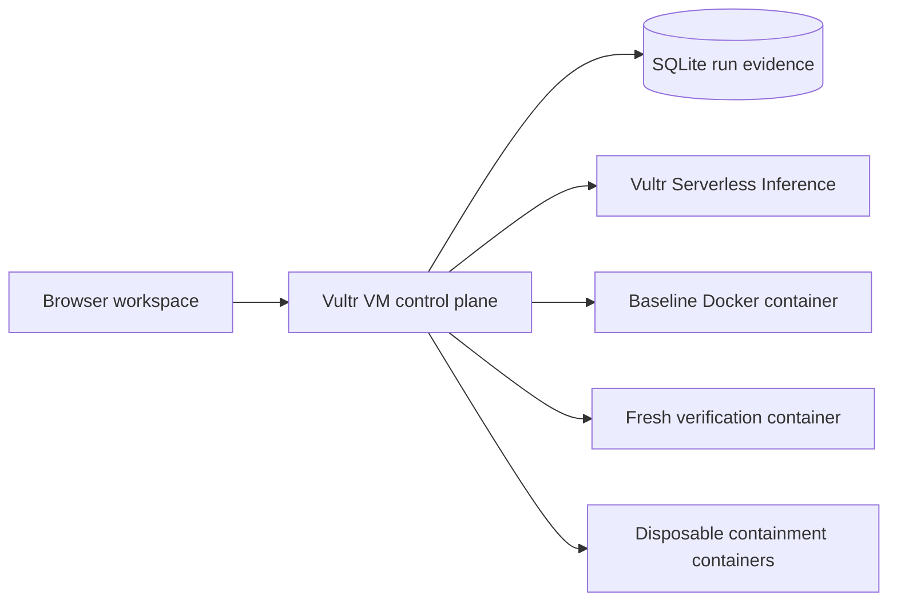

# VersionBridge AI

VersionBridge repairs a supported Python dependency failure and shows exactly what ran. Three bundled cases demonstrate a pandas 2 repair, a Pydantic settings migration, and rejection of a patch that drops audit metadata. Each unchanged pytest suite runs before and after a one-line candidate patch in fresh containers.

Built for Vultr Agent Rush, Blast Radius Zero.

## Run it locally

Requires Python 3.10+ and Docker.

```sh
docker build -t versionbridge-sandbox:1 -f Sandbox.Dockerfile .
python3 server.py
```

Open http://127.0.0.1:8787. Run the bundled repair, inspect the patch and sandbox IDs, then download the patch and JSON evidence. The containment lab makes real network and filesystem attempts, checks user identity and the kernel memory cap, and forces a timeout followed by a Docker cleanup check. SQLite retains the latest 100 repair runs and shows the latest 25 in the workspace. Local runs without inference credentials label the built-in patch explicitly.

The optional public GitHub import is enabled with `ENABLE_PUBLIC_IMPORT=1`. It resolves a branch or commit to an immutable GitHub SHA and runs a bounded migration profile. The project must be small and contain exactly one supported migration line for the selected profile. The image supplies pandas, NumPy, Pydantic, pydantic-settings and pytest. Dependency installation, private repositories and automated pushes are outside this profile.

See [acceptance and model evaluation](EVALUATION.md) for the real Docker tests, a pinned GitHub import, and a Vultr model comparison command.

## Architecture



The control plane streams newline-delimited JSON, validates the model's bounded expression, and records the patch, test checksum, exit codes, and sandbox lifecycle. A failed verification may trigger one retry with the previous test output. The model cannot modify tests, select shell commands, or authorize execution. The web app and orchestrator use Python and browser-native code to keep the demo deployable on one VM with Docker.

For live inference, set `VULTR_API_KEY` and optionally `VULTR_MODEL` in the server environment. The default candidate is Vultr's documented Qwen2.5 Coder 32B. Confirm availability for your account and override the model ID if needed. `REQUIRE_INFERENCE=1` makes missing credentials fail the repair instead of selecting the sample patch. See [Vultr deployment](deploy/README.md) for the systemd, environment, and nginx templates.

## Threat model

- Only public GitHub URLs and bounded refs are accepted. The importer uses fixed GitHub hosts, rejects redirects and unsafe archive paths, and caps compressed size, expanded size and file count.
- Repository code and test output are untrusted. The candidate expression is restricted to the supported pandas forms. Each container receives a read-only project copy, a non-root UID, a read-only root, no outbound network, no credentials or Docker socket, dropped capabilities, and CPU, memory, process, file and time limits.
- Uploaded repositories can contain adversarial tests or fabricate output. Imported-project evidence describes the observed exit and the supplied tests. The bundled fixture is the controlled verification example.
- The Docker socket is privileged and stays with the control plane. Use a dedicated Vultr VM and validate gVisor before enabling public repository execution. The public demo can run the bundled fixture with per-IP and global throttling.

## Submission

Use the [recording guide](DEMO.md) after deploying to Vultr. The [LabLab event page](https://lablab.ai/ai-hackathons/vultr-hackathon/) requires the Vultr-hosted public URL, public repository, cover and presentation materials, a demo video with a containment moment, and submission on LabLab.

MIT licensed. See [LICENSE](LICENSE).
