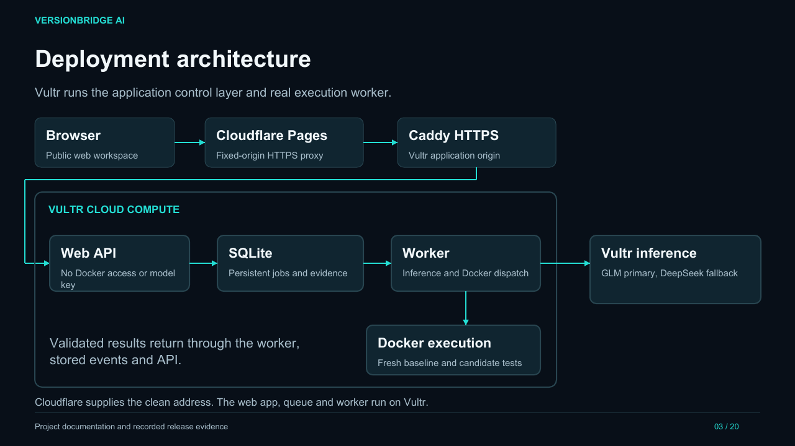

# Live demo and architecture slides

[Download the 20-slide PDF](VersionBridge-Live-Demo-and-Architecture.pdf) · [Open the live workspace](https://versionbridge.pages.dev/demo.html)

Prepared 9 November 2026, using actual deployed-app captures from 8 November 2026 (Asia/Kolkata). The PDF contains static screenshots of real execution; it is not a live dashboard. The homepage architecture animation is an explanatory guide, while the workspace workflow follows actual job events.

The deck covers the developer problem, deployment architecture, all 16 reviewed repair profiles across nine runtimes, model routing, live workflow, source and container inspection, evidence exports, regression rejection, containment, resources, persistent jobs, cancellation, access separation, usage limits, use cases and remaining boundaries.

## Captured outcomes

- **Two-file migration:** original test passed after repair; 102 independent checks passed; three containers removed.
- **Regression rejection:** a candidate broke audit metadata, so verification rejected it; two containers removed.
- **Containment:** network, filesystem, privilege, key isolation, timeout and memory-cap probes passed; three containers removed.

[Capture manifest](capture-manifest.json) records the tested application commit, run IDs, source URLs and PDF checksum. Archived [JSON reports and TXT bundle](evidence/) remain available if the service later expires these runs. [Original screenshots](screenshots/) accompany the PDF. Console screenshot filenames describe what is actually displayed.

The slide showing 56 Python test methods and 27 HTTP checks refers to the published release CI; these counts are distinct from the three fresh jobs shown in this deck. Broader repository repairs and automatic repair pull requests remain future development.

## Suggested demo order

1. Explain the dependency-update problem and architecture.
2. Run the two-file import migration in the workspace.
3. Open the execution inspector and compare the original and candidate files.
4. Review the unchanged test results and independent checks, then download TXT evidence.
5. Show regression rejection, containment and resource monitoring.
